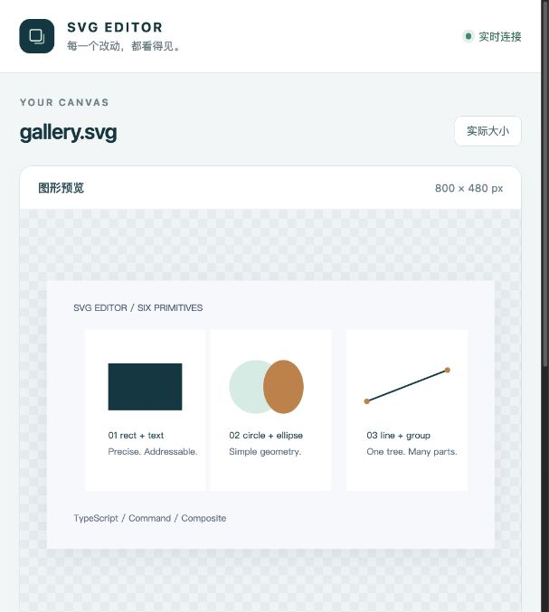

# SVG Editor · Lab 1

一个可以独立安装、支持脚本回放的 SVG 命令行编辑器。使用 TypeScript、Command 与 Composite 模式实现；现在提供未保存保护、恢复草稿和只读实时预览。

**公开仓库：[cqsh01/fudan-lab1-svg-editor](https://github.com/cqsh01/fudan-lab1-svg-editor)** · 当前版本：`0.3.0`

教授与助教可直接通过仓库地址查看、下载或克隆作业，无需登录 GitHub 或申请访问权限。课程交付入口为 [`final` 标签](https://github.com/cqsh01/fudan-lab1-svg-editor/tree/final)，正式技术文档位于 [doc/README.md](doc/README.md)。

0.3.0 增加终端字符预览：可随时执行 view，也可在编辑后自动显示当前画布。

## 从源码启动

需要 Node.js 22 或以上版本与 npm。在项目目录执行：

```sh
npm ci
npm run build
npm run cli -- --preview
```

打开终端打印的 `preview: http://127.0.0.1:…/…/` 地址。在终端编辑，浏览器中的画布自动更新。预览不会保存文件或清空撤销历史。

```text
svg> init 800 480
canvas 800x480 created
svg> create rect card 60 80 220 120 #133f4b
rect#card created
svg> create text title 80 146 "Hello SVG"
text#title created
svg> set title fill white
text#title updated: fill="white"
svg> status
canvas 800x480 (2 elements)
state: unsaved
file: "(not saved)"
svg> save drawing.svg
saved to drawing.svg (2 elements)
```

源码只在构建时编译，`npm run cli` 和已安装的命令均直接运行编译产物。修改 TypeScript 后重新执行 `npm run build`。

## 在终端查看当前图形

在 `svg>` 中输入 `view`，直接查看当前整张 SVG 画布。只画一个矩形时就只显示这个矩形；图形、文字和线条全部来自当前文档。

```text
svg> init 400 200
svg> create rect card 80 60 200 80 none
svg> set card stroke black
svg> view
```

编辑后自动打印预览：

```sh
npm run build
npm run cli -- --terminal-preview
```

成功新建、读取、编辑、调整画布、撤销、重做或保存后，会在下一次提示符前打印新画面；恢复启动也会显示恢复的画布。可同时启用 `--preview`，用浏览器确认精确效果。

字符边框使用 `+ - | / \\`，填充用 `.`；图形按 SVG 的位置、组合、样式继承和层叠顺序绘制。画布适应当前终端尺寸，按字符宽高约 1:2 保持整体比例，超出画布的内容裁剪。文字支持常见中文双格宽度。

这是布局近似：不区分颜色，描边统一近似为一格，文字位置/字号与曲线会有误差，极小图形可能合并，字体和 emoji 的实际宽度也受终端影响。边框同时表示有填充图形的几何轮廓；无填充且无描边的图形不显示。没有凭空生成的箭头或节点。精确样式使用浏览器预览。

`view` 不保存文件、不修改文档或撤销历史。默认脚本不会插入画面，只有显式 `view` 或 `--terminal-preview` 才输出字符画；使用普通文本输出，无需终端图像协议或光标控制。[单矩形回放](examples/terminal.commands)及其[实际输出](examples/terminal.transcript.txt)可以直接核对。

## 安装打包版本

```sh
npm run package
npm install --global ./lab1-svg-editor-0.3.0.tgz
svg-editor --help
svg-editor --preview
```

包中包含编译产物、运行依赖声明、文档和示例；安装包使用者不需要 TypeScript。GitHub 仓库公开，安装包通过本地 tarball 分发，尚未发布到 npm 公共注册表。package.json 的 `private: true` 用于禁止 npm 发布，与 GitHub 仓库可见性独立。

## 保存、退出和恢复

- `status` 查看文档是否有未保存修改；新建画布也属于尚未保存的文档。
- 交互模式中，`init`、`read`、`exit` 遇到未保存修改时，按 Enter 取消；只有输入 `discard` 才继续放弃。需要保存时先取消，再执行 `save`。
- Ctrl+D 或 Ctrl+C 结束交互时保留恢复草稿。重新启动时使用 `svg-editor --recover`；从源码使用 `npm run cli -- --recover`。
- 恢复目录默认是**当前工作目录**下的 `.svg-editor/recovery/`。从其他目录启动或自选位置时，在原会话和恢复会话中使用同一个 `--recovery-dir <目录>`。
- 成功保存会删除本会话的草稿；明确 `exit` 并放弃也会删除。其他会话的草稿不会一起删除。恢复后重新建立撤销历史，恢复动作不覆盖原 SVG。
- 普通 stdin 脚本不弹出确认，也不自动生成草稿。`--discard-unsaved` 可显式跳过交互保护，并在退出时放弃本会话草稿。

## 启动选项

| 选项 | 用途 |
| --- | --- |
| `-h` / `--help` | 显示使用说明并退出 |
| `-v` / `--version` | 显示安装版本并退出 |
| `--preview` | 启动本会话的只读实时预览 |
| `--terminal-preview` | 文档更新后在终端打印字符预览，可与浏览器预览同时启用 |
| `--port <数字>` | 指定预览端口；默认自动选择，0 也表示自动选择 |
| `--recover` | 显式恢复恢复目录中最近的完整草稿 |
| `--recovery-dir <目录>` | 选择恢复目录 |
| `--discard-unsaved` | 跳过交互询问，退出时放弃未保存草稿 |

预览只绑定本机 `127.0.0.1`，终端退出后服务关闭。浏览器可切换适应画布/实际大小，查看画布尺寸、图形数量和保存状态。



## 脚本与示例

```sh
npm run build
node dist/src/cli/Main.js < examples/flowchart.commands
node dist/src/cli/Main.js < examples/gallery.commands
# 安装后也可以：svg-editor < examples/flowchart.commands
```

`#` 开头的整行是注释；文本和带空格的路径使用双引号。`read/save` 的路径按字面值保留反斜杠，可直接写 `"C:\Users\name\My Art\drawing.svg"` 或 `"C:/Users/name/My Art/drawing.svg"`，不需要双写分隔符。输入 `help` 查看全部编辑命令，`tree` 查看结构，`exit` 结束会话。脚本模式不输出提示符，错误写入 stderr，继续处理后续行；有错误时返回非零退出码。

[两节点流程图](examples/flowchart.svg)和[六种图元画廊](examples/gallery.svg)完全由编辑器生成，对应 `.commands` 与 `.transcript.txt` 提供可回放记录。

## 验证与技术文档

```sh
npm run check
npm test
npm run test:package
```

- [Lab1 技术文档](doc/README.md)：架构方案、模式、依赖、过程、一致性和质量保证。
- [关系视图与 UML](doc/views.md)：组件图、核心类图、编辑与预览时序、恢复时序。
- [验收记录](doc/QA.md)：自动检查与实际终端/浏览器验证。
- [版本变更](doc/CHANGELOG.md)：本轮改进范围及保留的课程语义。

当前覆盖安装、保护/恢复、浏览器预览和终端字符预览。六种图元和 Phase 1 约定继续保留，box、插件系统和更广的 SVG 导入范围仍属于后续工作。所有项目文件位于 `lab1/`。

## 文件路径与文本转义

```text
svg> read "C:\Users\Alice\My Art\demo.svg"
svg> save "\\server\share\diagram.svg"
svg> set title text "First\nSecond"
```

前两行的反斜杠是路径本身的一部分；最后一行的 `\n` 会成为文本换行。普通文本继续支持 `\"`、`\\`、`\n`、`\r`、`\t`；路径仅把用于保护引号的 `\"` 还原为引号，其余反斜杠原样保留。

这些是进入程序后 `svg>` 提示符中的命令；CMD 启动行的引用规则由 CMD 处理。Windows 安装包验收通过真实 `cmd.exe` 执行 npm 生成的 `.cmd` 启动器，覆盖带中文和空格的安装目录、原生路径、UTF-8/CRLF 脚本及失败退出码。
