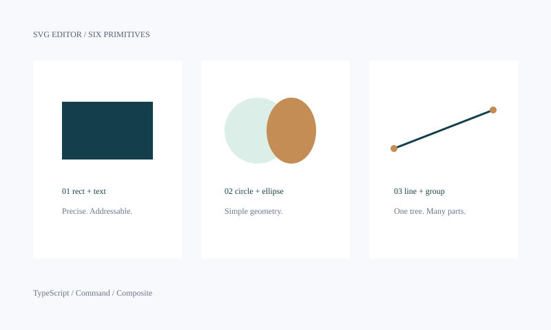

# SVG Editor · Lab 1

一个以结构、命令和可逆编辑为核心的 SVG 命令行编辑器。使用 TypeScript、Command 与 Composite 模式实现。

**仓库：[cqsh01/fudan-lab1-svg-editor](https://github.com/cqsh01/fudan-lab1-svg-editor)**（私有） · 最终版本：`final`



## 开始使用

需要 Node.js 22 或以上版本与 npm。在本项目目录执行：

```sh
npm ci
npm run build
npm run cli
```

```text
svg> init 800 600
canvas 800x600 created
svg> create g scene
g#scene created
svg> create rect card 40 60 180 80 #133f4b in scene
rect#card created in g#scene
svg> move scene 20 0
g#scene moved by (20,0)
svg> undo
undone: move scene
svg> save demo.svg
saved to demo.svg (2 elements)
```

输入 `help` 查看全部命令，Ctrl+D 退出。`tree` 展示嵌套结构与几何属性；保存的 SVG 可直接用浏览器打开。

## 脚本与示例

标准输入支持逐行回放，`#` 开头的整行视为注释。

```sh
npm run build
node dist/src/cli/Main.js < examples/flowchart.commands
node dist/src/cli/Main.js < examples/gallery.commands
```

- [两节点流程图](examples/flowchart.svg)：容器内创建、整体移动、撤销、文本更新与保存。
- [六种图元画廊](examples/gallery.svg)：统一配色、留白与层级，完全由本编辑器生成。
- 对应的 `.commands` 和 `.transcript.txt` 提供可回放命令和实际输出。

脚本模式不输出提示符；错误写入 stderr，继续执行后续命令，结束时返回非零状态。

## 验证与设计文档

```sh
npm run check
npm test
```

[doc/README.md](doc/README.md) 包含完整架构方案、设计模式、依赖规则、语义决策、过程记录、一致性自查与质量保证。当前交付 Phase 1 的六种内置图元与全部命令；SVG 导入范围和后续阶段边界也在文档中说明。

所有工程文件均位于 `lab1/`；仓库根就是该目录。
