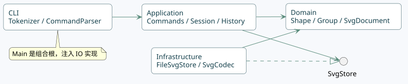

# Lab 1 · SVG 编辑器技术文档

仓库：[cqsh01/fudan-lab1-svg-editor](https://github.com/cqsh01/fudan-lab1-svg-editor)（私有）。当前版本 **0.2.0**；本轮修订日期 **2026-10-28**。原始要求保留在 `phase_cli_1.md`。

本次 Lab1 对应已发布的 Phase 1 CLI 要求。0.2.0 在原有六种图元和全部编辑命令之上，增加安装入口、未保存保护与恢复、只读预览。设计目标是让使用者可以独立启动、确认修改结果，并在操作失误或进程中断后找回已备份内容。它没有增加鼠标编辑或插件系统。

## 架构方案

### 模块划分与职责

| 模块 | 当前职责 | 允许依赖 |
| --- | --- | --- |
| `src/domain` | 图形几何、样式、树结构、唯一 id；文档克隆及内容比较 | 本模块，不依赖 Node、XML、终端或 HTTP |
| `src/application` | Command、编辑历史、会话、保存基线、修改版本；IO 端口 | domain、本模块 |
| `src/cli` | 分词、命令构造、交互编排、未保存确认、启动帮助；Main 装配依赖 | application、domain、本模块；只有 Main 导入基础设施或 Node |
| `src/infrastructure` | SVG 编解码、原子文件写入、草稿、终端、HTTP 预览和页面 | application 的端口、domain、本模块、Node/XML 库 |
| `test` | 领域、应用、CLI、保护、恢复、预览、入口和架构检查 | 产品模块与测试运行时 |
| `tools` | 安装包烟雾验收工具，不进入发行包 | Node；独立于产品运行 |
| `doc` / `examples` | 技术图源、导出图、操作说明、验收记录、可回放示例 | 不形成产品代码依赖 |



PlantUML 图源：[architecture.puml](architecture.puml)。完整[关系视图与 UML 说明](views.md)还包含类图、编辑/预览时序和恢复时序。

应用对象之间的关键关系：

- `SvgDocument` 组合一棵以 Group 为根的 Shape 树；Group 递归包含 Shape。
- `EditorSession` 持有当前文档、保存基线、递增 revision 和 CommandHistory。通过内容比较计算 dirty，避免把“历史位置相同”误认为“内容相同”。
- EditCommand 保存执行前后快照，CommandHistory 管理 past / future。失败候选不会进入当前文档或历史。
- EditorShell 接收 Terminal、RecoveryStore、Preview 端口；Cli 接收可选 UnsavedChangesGuard。原有纯命令调用和普通脚本不需要确认交互。
- EditorSession 实现 PreviewSource，PreviewServer 只取得防御性副本。浏览器仅获取状态和 SVG，无法通过预览服务调用编辑命令。
- FileSvgStore 与 FileRecoveryStore 复用 AtomicFileWriter，文件写入仍隔离在基础设施层。

### 设计模式的选择与落地

| 模式 / 原则 | 代码落点 | 选择理由与边界 |
| --- | --- | --- |
| **Command（必需）** | Command、EditCommand、独立命令类、CommandHistory | 一次编辑一个撤销单元；新增 status、exit 也通过同一注册点构造 |
| **Composite** | Shape、GeometryShape、六种图形、Group | 命令通过统一操作处理容器和叶子，禁止在每个命令中枚举类型 |
| **Memento** | EditCommand.before / after、SvgDocument.clone | 精确恢复浮点与树结构；每条历史 O(n) 空间，暂不引入增量补丁 |
| **Factory** | ShapeFactory | 图形名唯一分派点，CLI 与 XML 读取共用 |
| **端口与适配器** | SvgStore、RecoveryStore、Terminal、Preview、PreviewSource | 命令和会话不直接读文件或启动服务；在测试中替换 IO |
| **依赖注入** | Main | 唯一组合根选择终端、草稿、预览实现，不把平台行为放进领域类 |

本轮没有为了展示模式而引入额外事件总线。预览采用定时读取快照；Shell 根据 revision 判断是否需要更新草稿，已经能满足当前规模。

命令名只在 CommandParser 分派，图形类型名只在 ShapeFactory 分派。命令的替换/退出能力通过多态属性表达，确认保护不重新比较命令名。启动参数由 Node 的 parseArgs 解析，不另建编辑命令分派点。按照原要求，两个内置注册表仍登记为插件化阶段的待重构点。

### 依赖方向规则

1. domain 仅依赖 domain；Shape 对 Group 的回指为 type import。
2. application 可依赖 domain 和 application，禁止 fs、http、XML 或具体适配器。
3. cli 通过应用端口读写终端、维护草稿及启动预览；Main 是导入 Node 与 infrastructure 的唯一例外。
4. infrastructure 依赖应用端口、领域与本模块；不导入具体 EditorSession 或 CLI 实现。
5. XML DOM 类型只在 SvgCodec 内使用。HTTP 的状态 JSON 和图片编码不会越过 PreviewSource 端口进入领域。
6. test/tools 可以使用测试运行时；工具不进入运行时包。

`test/architecture.test.ts` 扫描静态导入边界、类名与文件名、生产代码无顶层过程函数。该扫描不等价于完整 TypeScript 语义分析，仍需要人工核对图与实际导入。

### 变化点假设

| 变化点 | 当前保留的边界 / 决定 |
| --- | --- |
| 新图元与插件 | 保留 Shape 多态、工厂和命令注册点；本阶段不实现 box、插件生命周期 |
| 新输入方式 | 命令对象与会话独立于终端，后续可注入其他输入适配器；只读预览不充当第二编辑入口 |
| 备份存储或恢复格式 | RecoveryStore 独立于 SvgStore；JSON version=1，内含 SVG 与原文件绝对路径，便于将来迁移 |
| 预览传输方式 | Preview / PreviewSource 独立端口；当前 700 ms 轮询，无需 WebSocket 或消息队列 |
| 大图与长历史 | 当前是全量快照、内容比较和树遍历；先测量再选择索引/增量历史，不在本轮扩大重构 |
| 国际化 | CLI 保留课程英文协议，预览和文档为中文；没有引入翻译运行时 |
| 分发 | tarball 包含已编译 JS，用户只安装运行依赖；保留 private，未发布到公共注册表 |

## 功能与行为约定

### 原有 Phase 1 语义

- 支持 rect、circle、ellipse、line、text、g；id 全局唯一、大小写敏感、不可为空或包含空白。
- move 增量移动；scale 以原点缩放位置与尺寸、因子为正。stroke-width 和字号不属于本阶段几何缩放。
- g 的样式位于容器本身，遵循 SVG 继承，子元素显式样式优先。
- group 按文档顺序收编；跨父容器时位于最近公共祖先、第一个被选分支的位置。容器与其后代同时入组、重复成员及循环归属均拒绝。
- 顶层 g 禁止 ungroup；嵌套 g 的子节点按顺序提升并占据原位置。front 为同级末尾，back 为同级开头。
- 数字必须有限；几何尺寸、半径和描边可为 0、不可为负；画布宽高为正。
- 每个成功编辑一个 undo 单元，失败不改状态或历史。undo 后的新编辑清空 redo。
- 成功 init/read/save/修改尺寸的 canvas 清空历史并设置屏障；下一次成功编辑解除。查询 canvas、tree、show、help、status 和预览不改变历史。
- save 无参数使用最近一次成功 read/save 的路径；init 清除路径。相对路径以当前工作目录为准。
- `svg>` 提示符、双引号转义、整行 # 注释及 `error:` 单行错误协议保持。普通 stdin 脚本错误后继续，最后返回非零状态。

### 保存基线、保护和恢复

新建文档属于 dirty；读取和成功保存建立干净基线。修改后的 dirty 通过文档内容比较计算，undo 到保存时内容会变为干净，redo 再次变脏。失败 IO 不更新基线。

交互终端的 init/read/exit 在 dirty 时要求输入 `discard`，Enter 或其他输入取消。取消不执行命令、不进入历史、不改变草稿。确认后若 read 失败，原文档与原草稿仍保留。普通脚本不会询问；--discard-unsaved 显式跳过交互保护，并在退出时清除本会话草稿。

EditorShell 在成功修改后、打印下一次提示符前更新草稿。写草稿失败是独立的 warning，编辑本身仍成功，文档保留在内存；不会把备份失败伪装成编辑失败。正常结束时如果当前内容无法备份，退出状态为非零且不会声称已备份成功。

默认恢复目录为工作目录下 `.svg-editor/recovery/`，可用 --recovery-dir 覆盖。每个会话使用独立随机文件名，草稿与 SVG 保存都先写同目录临时文件，再 rename。新文件请求 0600、目录请求 0700，实际权限受文件系统能力影响。

草稿格式 version=1，包含标准 SVG 与可选原文件绝对路径，单个草稿上限 16 MiB。--recover 验证最近草稿后通过 rename 认领到新会话文件；无效草稿不删除、不静默跳过。恢复后的文档为 dirty，undo/redo 从新的 IO 屏障开始。原 SVG 只会在显式 save 时写入。

成功 save 和明确 exit/放弃会清理本会话草稿；Ctrl+D、Ctrl+C 或正常收到终止信号会保留未保存草稿。异常强制终止可以恢复最后一个完整检查点，不承诺尚未完成的写盘、未提交命令或断电后的持久性。--recover 不应针对仍在编辑的其他会话使用。

### 实时预览

--preview 可选启用 HTTP 适配器，只监听 127.0.0.1，默认随机端口，可用 --port 指定。随机路径和 Host 校验限制访问；没有文件浏览、上传或编辑路由。服务只接受 GET/HEAD，使用 CSP、no-store 和 nosniff。

页面从 state 接口读取尺寸、图形数量、文件名、dirty、revision；revision 改变时获取新的 SVG，以 img 渲染。文档名用 textContent 写入，不把用户内容拼成 HTML。浏览器资源随 JS 打包，无外部字体或 CDN。窄屏采用上下布局，支持适应画布与实际大小切换。

获取预览只克隆文档并编码，不调用 save、不改变 dirty 或历史。会话结束关闭 HTTP 服务，页面显示连接结束并保留最后画面。界面截图见 [preview.png](preview.png)。

### SVG 支持边界

输出为 UTF-8 标准 SVG，带 namespace、width、height 和与画布一致的 viewBox。输入覆盖六种图元、g 嵌套、各自几何属性以及 fill/stroke/stroke-width；文本是子文本，省略几何采用 0 初值。

根宽高支持数字或 px，缺省为 800×600；现阶段 viewBox 须为 `0 0 width height`。先预留全部显式 id 再补缺失 id，避免与后面的 rect1 等冲突。

transform、style/CSS、字体属性、path/use/defs、tspan、非等比例 viewBox 和 DTD 等额外语法明确拒绝，保留原文档。背景知识的 transform 示例和未来 box 定义不扩展本次必做范围。本轮没有静默忽略或降级读取这些语法。

## 过程记录

| 日期 / 轮次 | 实际问题或反馈 | 决策、改动与证据 |
| --- | --- | --- |
| 10/18 · 需求与架构 | 初始目录只有 Phase 1 说明与含仓库地址的提交要求 | 保留原文；先写架构，分领域、应用、CLI 和测试提交 |
| 10/18 · 事务模型 | 逆向浮点操作可能无法精确还原，复合操作可能中途失败 | 使用候选文档与前后快照；验证浮点恢复、半途溢出和历史原子性 |
| 10/18 · XML | 自动 id 可能撞到后面显式 id；XML 会规范化回车 | 先预留 id，回车使用字符引用，增加回归用例 |
| 10/18 · 环境 | 外置磁盘生成 ._ 元数据；TypeScript 7 未提供旧 AST API | 测试忽略系统元数据；依赖扫描加人工抽查，如实记录局限 |
| 10/27 · 范围澄清 | 用户担心把整个项目与本次 Lab1 混为一谈 | 对照 Phase 1 原文确认当前交付范围；没有虚构未收到的后续要求 |
| 10/28 · 产品反馈 | 用户转述老师期待市场认可，并明确选定高优先级改进 | 先记录 improvement-plan，选择安装、保护/恢复、轻量预览三项，未提前实现插件 |
| 10/28 · 安装 | 每次 npm run cli 都构建，安装者依赖源码和开发工具 | 分离 build 与启动，增加 bin/prepack/help/version；干净目录安装 tarball 验收 |
| 10/28 · 成果保护 | init/read/退出可丢弃未保存编辑 | 基线内容比较、统一替换能力、交互确认、独立恢复端口；实际测试取消后状态和 redo 不变 |
| 10/28 · 恢复 | 备份失败不能误报编辑失败；同时恢复不能共享一个草稿 | 草稿失败输出 warning；完整验证后 rename 认领，保存/放弃只清理本会话文件 |
| 10/28 · 预览 | 手动保存看效果会触发课程历史屏障 | 通过 PreviewSource 读取内存副本；实际浏览器验证刷新、撤销后的 saved 状态和大小切换 |
| 10/28 · 验证修订 | fetch 会改写测试中的 Host，旧架构正则也扫描到模板内 JS | 使用原始 HTTP 请求验证 Host；页面代码整理为可读模板，保留架构扫描能力边界 |

这些是实际对话、实现和检查记录，未代写未经发生的用户试用反馈。分步 Git 提交体现推进过程；同一场会话中的多次提交不等于多次课堂评审。

## 一致性自查

实际目录与上表一致。相对原始方案的修订均已记录：

- 新增 Terminal、RecoveryStore、Preview、PreviewSource 端口及各自适配器，替换原 Main 中直接操作 readline 的编排。
- DocumentFormatter 仍为应用层只依赖领域的文本输出服务。
- Main 是唯一组合根；EditorShell 和 UnsavedChangesGuard 不导入文件系统或 HTTP。
- PreviewServer 只依赖 PreviewSource 端口，不直接依赖 EditorSession；草稿与保存复用基础设施内部 AtomicFileWriter。
- 发布校验放在 tools，不把开发工具带入安装包；用户现有 demo.svg 不修改、不提交、不打包。

依赖规则由 architecture.test.ts 检查。人工抽查：MoveCommand → EditCommand/SvgDocument；EditorSession → SvgStore/PreviewSource；EditorShell → 应用端口；FileRecoveryStore → RecoveryStore/SvgCodec/AtomicFileWriter；PreviewServer → Preview/PreviewSource/SvgCodec/PreviewPage。未发现逆向业务依赖。

待处理项仍为命令/图形注册表的后续插件化，以及在实际性能证据支持下再优化历史与树索引。

## 质量保证手段

```sh
npm ci
npm run check
npm test
npm run test:package
```

- 自动检查覆盖原有全部命令、六种图元、失败原子性、IO 屏障、dirty 基线、取消保护、恢复格式与生命周期、预览只读性/历史隔离、CLI 入口和模块边界。
- 安装包检查在 lab1 内临时目录安装 tarball，仅安装运行依赖，验证 bin/help/version/stdin，并确认不包含用户文件或 TypeScript 开发依赖。
- 真实终端检查覆盖粘贴多行、确认答案、Ctrl+D、重新启动恢复和另存；真实浏览器核对空文档、自动刷新、dirty/saved、窄屏与大小切换。
- GitHub CI 对 Node.js 22/24 执行类型、功能与包安装检查，并覆盖 Linux/Windows。

详细结果、实际检查环境和边界见 [QA.md](QA.md)。本地测试通过和可用性检查提供工程证据，尚未进行真实用户留存或商业市场验证。

## 交付资料

Git 标签保留原始基线 `v0.1.0` 与本轮改进版 `v0.2.0`；课程当前交付标签 `final` 指向经过验证的本轮版本。提交历史保留每个阶段的实际推进，不改写原有提交。


- [根 README](../README.md)：安装、运行、保存、恢复、预览与脚本使用。
- [views.md](views.md)：关系视图与 UML 图源索引。
- [QA.md](QA.md)：可复现的自动/人工验收记录。
- [CHANGELOG.md](CHANGELOG.md)：基线与本轮版本变更。
- [improvement-plan.md](improvement-plan.md)：用户选择后的三项改进与验收计划。
- 原课程要求仍以仓库根 `phase_cli_1.md` 为准；所有改动限定在 lab1 内。
