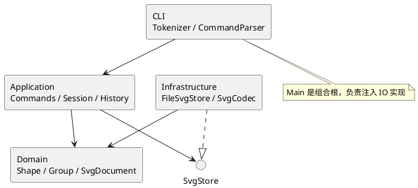

# Lab 1 · SVG 编辑器设计与交付记录

## 架构方案

本阶段交付纯 CLI，覆盖 rect / circle / ellipse / line / text / g 六种类型。视觉设计体现在 SVG 示例的配色与留白，以及终端的层次、短反馈和稳定错误格式；不增加阶段之外的 GUI。

| 模块 | 职责 | 允许依赖 |
| --- | --- | --- |
| `src/domain` | 封装几何、样式、父子树、唯一 id 和结构约束 | 本模块；不依赖 Node、XML 或 CLI |
| `src/application` | 编辑会话、Command 对象、历史、文件读写端口 | domain、本模块 |
| `src/cli` | 分词、命令构造、交互和标准输入；入口完成依赖装配 | application、domain；仅 Main 装配 infrastructure |
| `src/infrastructure` | SVG XML 编解码、Node 文件系统适配 | application 的端口、domain、Node/XML 库 |
| `test` | 领域不变量、命令行为、SVG 往返与 CLI 集成验证 | 全部产品模块 |

组件图（PlantUML）：

### 设计模式的选择

- **Command（必需）**：每条命令对应独立类；可编辑命令继承 EditCommand，保存执行前后文档快照，通过 execute / undo / redo 实现历史操作。一次 group 是一个命令、一个撤销单元。
- **Composite**：Shape 定义 move / scale / set / clone / describe；叶子处理自己的几何，Group 递归委派几何操作，样式保留在容器上遵循 SVG 继承。命令无须分派每种图形。
- **Memento**：历史保存完整领域文档副本，恢复时不依赖 XML/文件系统，不使用逆向浮点运算。代价是每条历史 O(n) 空间；本实验的小画布选择可靠性，暂不实现增量补丁。
- **Factory**：ShapeFactory 是图形类型名到构造器的唯一分派点，也被 XML 读取复用。命令名只在 CommandParser 注册表分派。按课程要求，这两处登记为后续插件化阶段的待重构点。
- **端口与适配器**：应用层仅依赖 SvgStore 接口，CLI 的组合根注入 FileSvgStore，内核不直接读写磁盘。

### 依赖方向规则

领域层位于依赖底部。应用层只向领域和 IO 抽象依赖；文件适配器实现该抽象。入口之外的 CLI 类不导入 infrastructure。XML 类型不越过 IO 边界。禁止 domain 反向导入 application / cli / infrastructure，禁止命令直接使用 fs。

### 变化点假设

1. 新增图形：复用 Shape 多态与工厂；本阶段不实现 box、动态插件加载和插件生命周期。
2. 新增操作与输入通道：Command 与会话可复用；新增 CLI 命令仍需注册，不提前创建 GUI 或 agent 接口。
3. SVG 文件支持范围：编解码隔离于内核；外部 SVG 的额外语法必须显式支持或拒绝，避免读入后静默丢失。
4. 大文档和长历史：当前用快照保证原子性与精确恢复；有实际性能证据时再换增量历史。
5. 输出国际化：当前遵守实验英文错误协议，中文用于文档与示例；尚无多语言运行时需求，不设置翻译框架。

## 过程记录

| 阶段 | 发现 / 决策 | 验证与修订 |
| --- | --- | --- |
| 需求核对 | 目录初始只有 phase_cli_1.md 和剪贴要求；要求额外提交含仓库地址的 README | 保留原始说明；以 Phase 1 CLI 为范围，不把后续 box 插件误当本阶段要求 |
| 架构先行 | 分派只能出现在命令构造和图形工厂；几何编辑须以多态表达 | 先记录依赖规则和模式，再分步实现 |

后续实现、检查结果与修订将在完成后据实补入。

## 一致性自查

实现完成后补入实际目录、依赖检查和待处理项。

## 质量保证手段

计划验证：全部命令、原子失败、分组与循环约束、历史屏障、SVG 特殊字符/缺 id/重复 id、保存读回，以及标准输入脚本的端到端运行。最终结果见后续记录。
