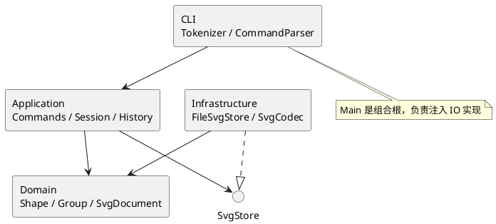
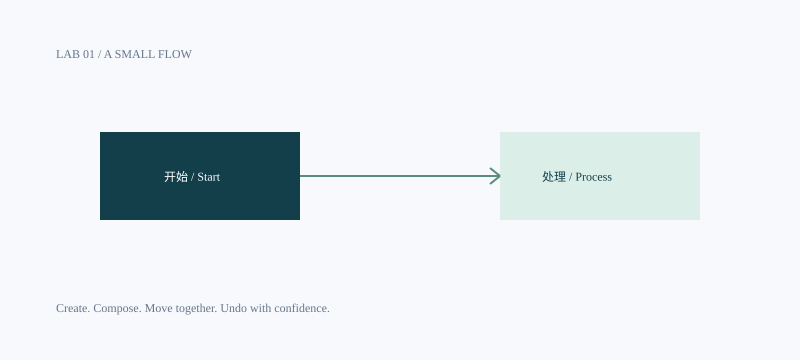

# Lab 1 · SVG 编辑器设计与交付记录

## 架构方案

本阶段交付纯 CLI，覆盖 rect / circle / ellipse / line / text / g 六种类型。视觉设计体现在 SVG 示例的配色与留白，以及终端的层次、短反馈和稳定错误格式；不增加阶段之外的 GUI。

| 模块 | 职责 | 允许依赖 |
| --- | --- | --- |
| `src/domain` | 封装几何、样式、父子树、唯一 id 和结构约束 | 本模块；不依赖 Node、XML 或 CLI |
| `src/application` | 编辑会话、Command 对象、历史、文件读写端口 | domain、本模块 |
| `src/cli` | 分词、命令构造、交互和标准输入；入口完成依赖装配 | application、domain；仅 Main 装配 infrastructure |
| `src/infrastructure` | SVG XML 编解码、Node 文件系统适配 | application 的端口、domain、Node/XML 库 |
| `test` | 领域不变量、命令行为、SVG 往返与 CLI 集成验证 | 全部产品模块 |

组件图（PlantUML，独立源文件见 [architecture.puml](architecture.puml)）：




### 设计模式的选择

- **Command（必需）**：每条命令对应独立类；可编辑命令继承 EditCommand，保存执行前后文档快照，通过 execute / undo / redo 实现历史操作。一次 group 是一个命令、一个撤销单元。
- **Composite**：Shape 定义 move / scale / set / clone / describe；叶子处理自己的几何，Group 递归委派几何操作，样式保留在容器上遵循 SVG 继承。命令无须分派每种图形。
- **Memento**：历史保存完整领域文档副本，恢复时不依赖 XML/文件系统，不使用逆向浮点运算。代价是每条历史 O(n) 空间；本实验的小画布选择可靠性，暂不实现增量补丁。
- **Factory**：ShapeFactory 是图形类型名到构造器的唯一分派点，也被 XML 读取复用。命令名只在 CommandParser 注册表分派。按课程要求，这两处登记为后续插件化阶段的待重构点。
- **端口与适配器**：应用层仅依赖 SvgStore 接口，CLI 的组合根注入 FileSvgStore，内核不直接读写磁盘。

### 依赖方向规则

领域层位于依赖底部。应用层只向领域和 IO 抽象依赖；文件适配器实现该抽象。入口之外的 CLI 类不导入 infrastructure。XML 类型不越过 IO 边界。禁止 domain 反向导入 application / cli / infrastructure，禁止命令直接使用 fs。

### 变化点假设

1. 新增图形：复用 Shape 多态与工厂；本阶段不实现 box、动态插件加载和插件生命周期。
2. 新增操作与输入通道：Command 与会话可复用；新增 CLI 命令仍需注册，不提前创建 GUI 或 agent 接口。
3. SVG 文件支持范围：编解码隔离于内核；外部 SVG 的额外语法必须显式支持或拒绝，避免读入后静默丢失。
4. 大文档和长历史：当前用快照保证原子性与精确恢复；有实际性能证据时再换增量历史。
5. 输出国际化：当前遵守实验英文错误协议，中文用于文档与示例；尚无多语言运行时需求，不设置翻译框架。

## 过程记录

| 阶段 | 发现 / 决策 | 验证与修订 |
| --- | --- | --- |
| 需求核对 | 目录初始只有 phase_cli_1.md 和剪贴要求；要求额外提交含仓库地址的 README | 保留原始说明；以 Phase 1 CLI 为范围，不把后续 box 插件误当本阶段要求 |
| 架构先行 | 分派只能出现在命令构造和图形工厂；几何编辑须以多态表达 | 先记录依赖规则和模式，再分步实现 |
| 领域模型 | 容器操作应通过 Shape 多态处理，不能每条命令枚举六种类型 | 叶子封装几何，Group 递归变换；测试嵌套移动、缩放、克隆隔离与循环约束 |
| 命令与历史 | 用反向移动撤销会累积浮点误差，组合操作中途失败还可能留下部分修改 | 改用候选文档 + 前后快照；验证 0.1/0.2 精确恢复，以及组内数值溢出时原文档与历史不变 |
| SVG 导入 | 一边读取一边给元素补 id，会和后面显式出现的 rect1 冲突 | 先预留整棵树的显式 id，再分类型补号；只在成功读入后输出警告 |
| XML 往返 | 实际往返检查发现原始回车符被 XML 规范化为换行 | 序列化时将回车写成字符引用；加入回车、换行、制表符与 Unicode 分隔符的回归用例 |
| 文件验证 | 外置磁盘上的 macOS 会额外创建 ._ 元数据，最初的目录清理断言误报 | 文件清理测试只忽略系统元数据，继续核对实际 SVG 与临时文件清理 |
| 架构检查 | 本机安装的 TypeScript 7 未提供旧版编译器 AST API | 采用针对当前源码导入声明的静态扫描，配合人工抽样；如实保留该检查不等于完整语义分析的边界 |
| 示例验收 | 只运行内存对象无法证明 CLI 入口和 XML 文件正确衔接 | 子进程回放两份示例，逐字比较实际生成文件与已提交 SVG；用系统 SVG 渲染预览核对文字、对齐与留白 |
| 远程交付 | 用户选择 GitHub 私有仓库；HTTPS Git 通道出现连接错误 | 使用同一仓库的 SSH 443 通道完成上传；临时仓库部署凭据在交付后移除 |

以上为本次与 AI 协作中实际发生的设计与验证记录，没有补写未经发生的人工讨论。开发过程通过架构、领域、应用、CLI、验证、文档等独立提交体现。

## 一致性自查

**模块划分一致。** 实际目录如下：

```text
src/
  domain/                 Shape、GeometryShape、六种图形、SvgDocument、ShapeFactory
  application/            EditorSession、CommandHistory、Command、EditCommand、DocumentFormatter
    commands/             每个命令独立一个类与文件
    ports/SvgStore.ts     SVG 文件读写抽象
  cli/                    Tokenizer、CommandParser、Cli、Main
  infrastructure/         SvgCodec、FileSvgStore
test/                     domain、application、cli、svg、architecture 五组检查
  fixtures/other.svg      课程示例输入
examples/                 命令脚本、实际输出与生成的 SVG
doc/                      本文与 PlantUML 图源
.github/workflows/ci.yml   Node.js 22 / 24 的 CI 检查
```

DocumentFormatter 放在应用层，为显示命令生成可复用的文本结果；它只依赖领域模型，不依赖终端。该职责在初始模块划分中未细列，现补充记录，未改变模块边界。

**依赖方向未发现违反。** `test/architecture.test.ts` 扫描生产源码的静态 import，检查前述模块边界、领域层无外部依赖、一类一文件、无顶层过程函数。人工抽查：

- `MoveCommand → EditCommand / SvgDocument`：通过领域接口移动，不导入 Node/fs/XML。
- `EditorSession → SvgStore`：使用端口类型，不导入 FileSvgStore。
- `FileSvgStore → SvgStore / SvgDocument / SvgCodec`：实现 IO 边界。
- `Main → Cli / EditorSession / FileSvgStore`：组合根是 CLI 装配基础设施的唯一位置。
- `Shape → Group` 等回指仅为 type import；运行时不借助类型枚举分派操作。

**待处理项**：CommandParser 和 ShapeFactory 的内置注册表在插件化阶段替换为注册接口；本阶段按要求保留这两个名字分派点。未实现 box 及插件系统，不宣称已经实现它们。

## 语义决策与支持边界

### 编辑与结构

- id 大小写敏感、全局唯一，不能为空或包含空白。显示时按 SVG 顺序输出，同级后面的元素覆盖前面的元素；`front` 放到同级末尾，`back` 放到开头。
- `group` 按原文档深度优先顺序收编，忽略参数中刻意颠倒的顺序。若来自不同父容器，新组位于最近公共祖先中、第一个被选中分支之前；原父容器即便变空也保留。这是对规范未明确位置规则的补充。
- 容器与其子孙不能同时被 group；addto 禁止自己移入自己或后代。重复 group 成员视为错误。
- 按题目要求，SVG 直接子级的 g 禁止 ungroup。嵌套 g 的子节点提升到父级，按原顺序占据 g 的位置。
- move 为增量位移；scale 将全部后代的位置和尺寸乘以正数，围绕 SVG 原点缩放；stroke-width 和文本字号不属于本阶段的几何缩放属性。
- g 的 fill / stroke / stroke-width 写在容器本身，遵循 SVG 继承；子元素显式样式优先。g 不接收叶子专属几何属性。
- 几何数值必须有限，尺寸、半径、描边宽度可为 0、不能为负；画布宽高必须为正。坐标可为负或浮点。

### 历史与 IO

- 每条成功编辑是一个 undo 单元；失败命令不修改文档、undo 栈或 redo 栈。
- 成功的 init / read / save / canvas 改尺寸清空历史并设置屏障。undo 和 redo 都返回 `error: undo not allowed after io command`，直到下一次成功编辑解禁。canvas 查询、tree、show、help 均不改变历史。
- undo/redo 的反馈形式为 `undone: move r1` / `redone: move r1`；用 tree/show 检查当前值。它们恢复快照，不重新执行浮点运算。
- `save` 无参数使用最近一次成功 read 或 save 的路径；init 清除路径。文件路径相对于启动时的工作目录，带空格的路径用双引号。
- 保存先在目标目录写临时文件，再 rename 替换；失败则清理临时文件。内存中的路径与历史只在写入成功后更新。不会自动创建不存在的父目录。
- help、注释和空行可在尚无文档时使用；其余正常命令需要 init/read。

### SVG 输入范围

输出为标准 UTF-8 XML，包含 namespace、width、height 和 `viewBox="0 0 width height"`，可直接在浏览器预览。输入支持六种内置图元、嵌套 g、各自的数值几何属性和 fill / stroke / stroke-width；text 内容读取为子文本。缺失几何值采用 SVG 的 0 初值，不写入省略的样式。

根宽高支持数字或 px，缺失时采用 800×600；viewBox 若存在，须与上述画布坐标一致。没有 id 或空 id 的图元按标签名与序号补齐并警告；重复显式 id 报错。

该实现是课程要求的可编辑 SVG 子集。transform、style/CSS、path/use/defs、tspan、字体属性、非等比例 viewBox 和 DTD 等额外语法会明确报错，保留原文档；不会静默读取后丢失这些渲染语义。背景知识里的 transform 示例用于解释 SVG，不在本阶段 CLI 支持清单内。后续扩展应在 SvgCodec 与领域协议中显式建模，再添加往返验证。

### CLI 协议

双引号支持 `\"`、`\\`、`\n`、`\r`、`\t` 转义；颜色里的 # 是普通参数，只有整行第一个非空白字符是 # 时才作为注释。所有错误为单行 `error:`。交互模式显示 `svg>`；标准输入脚本不显示提示符。脚本即使某行失败仍处理后续行，结束时退出码为 1；全部成功则为 0。

## 质量保证手段

在 lab1 目录执行：

```sh
npm ci
npm run check
npm test
```

本地验收通过 **23 项测试**。测试目录中的五个文件承担不同层次的验证：

| 检查 | 覆盖与证据 |
| --- | --- |
| domain.test.ts | 深层移动与缩放、克隆隔离、同级与跨父级分组、提升顺序、循环与重复 id、数值范围 |
| application.test.ts | 命令粒度、redo 分支清空、失败保留历史、浮点恢复、中途异常原子性、IO 屏障 |
| cli.test.ts | 全部命令与六种类型、in、引号/空文本/颜色、约定错误、真实文件 IO、stdin 子进程与退出码、示例回放 |
| svg.test.ts | 六类型往返、特殊字符、缺 id 的全局冲突、重复 id、非法/不支持输入、原子文件替换与临时文件清理 |
| architecture.test.ts | 静态 import 边界、生产类文件命名、无顶层过程函数 |

GitHub Actions 对 Node.js 22 / 24 执行安装、类型检查和同一测试集；实际远程结果以仓库 [Actions](https://github.com/cqsh01/fudan-lab1-svg-editor/actions) 为准。本地验证环境为 Node.js 25.1.0；依赖由 package-lock.json 固定。

两份示例输出已使用 SVG 渲染预览核对，示例回放会逐字比对生成的 SVG。交互入口也已实测提示符、创建、移动、撤销、属性显示和 Ctrl+D 退出。测试不会把“可通过类型检查”当成功能完整的唯一依据。

当前规模选择全量快照与树遍历：历史内存随图元数与操作数增长，查询与编辑不针对超大文档优化。本阶段不增加缓存、增量补丁、无限 SVG 兼容或插件生命周期框架。

## 提交与复现

- 私有 Git 仓库：[cqsh01/fudan-lab1-svg-editor](https://github.com/cqsh01/fudan-lab1-svg-editor)。访问者需具备该仓库权限。
- 最终版本标签：`final`。在具有权限的环境中 clone 后 checkout 该标签即可复现。
- 项目目录就是 Git 根目录，未修改 lab1 外的课程目录。原始需求保留于 `phase_cli_1.md`。
- 运行方式见根 [README.md](../README.md)；两节点示例见 [flowchart.commands](../examples/flowchart.commands)，画廊见 [gallery.commands](../examples/gallery.commands)。


