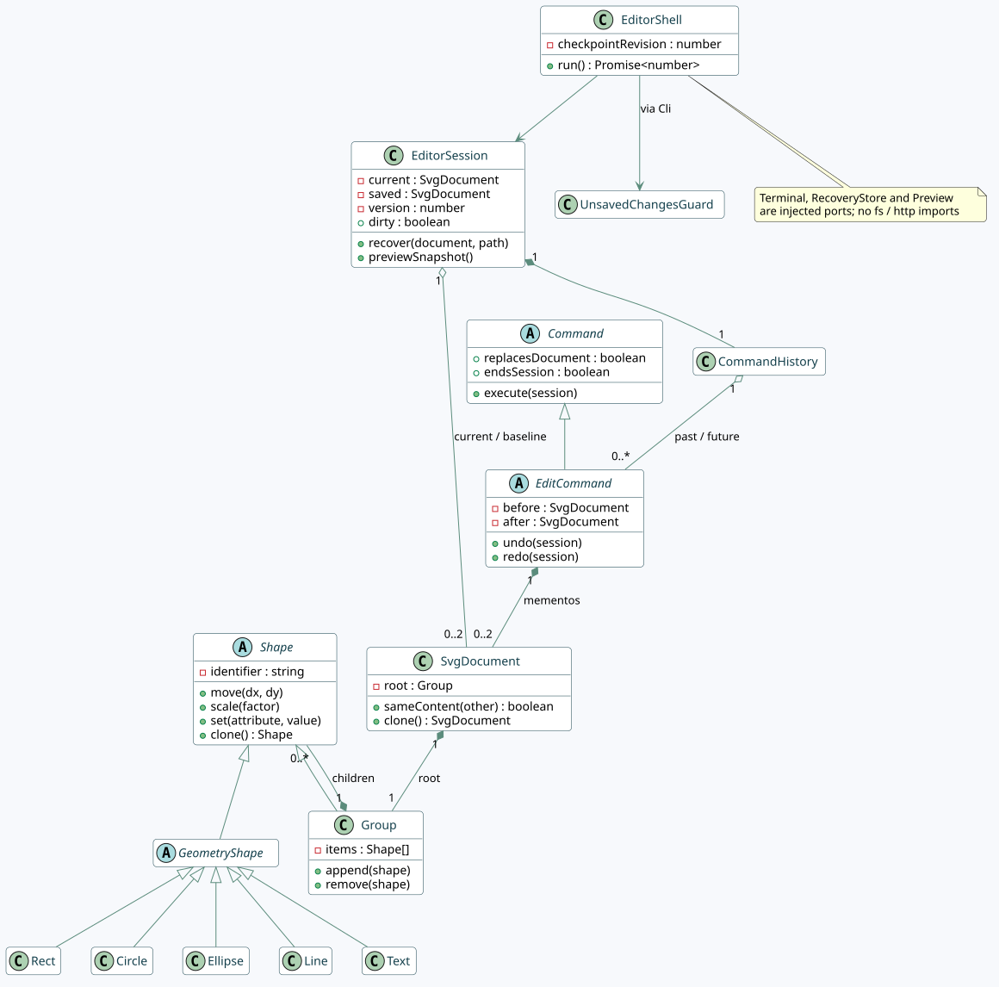
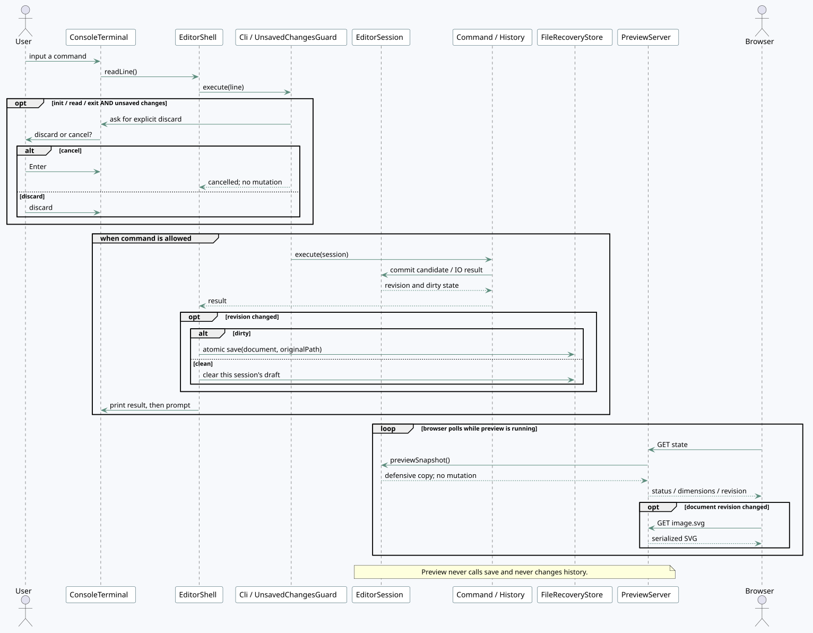
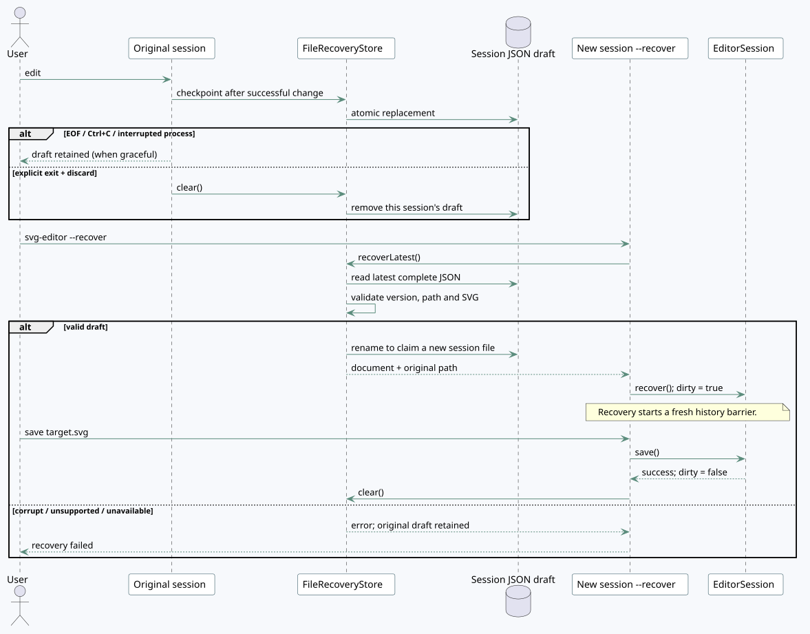
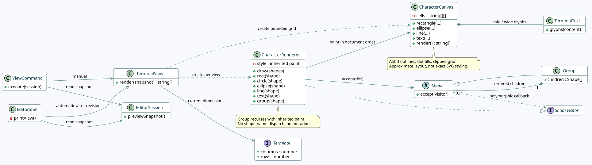

# 关系视图与 UML · 0.3.0

本页中的五组图对应 0.3.0 代码。图源为 PlantUML，导出 SVG 随文档提供，无需安装绘图工具即可查看。字符预览的组件、类与时序均已同步。

## 组件与依赖关系

[architecture.puml](architecture.puml) 表达 domain / application / cli / infrastructure 边界，以及 SvgStore、RecoveryStore、Terminal、Preview、PreviewSource 的实现和使用关系。Main 负责注入，预览的读取方向不会反过来进入命令执行。

0.3.0 增加应用层 TerminalView/字符渲染组件；终端尺寸通过 Terminal 注入，图形访问通过 domain 中的 ShapeVisitor。

## 核心类与所有权

[classes.puml](classes.puml) 表达 Shape 继承层次、Group 的递归组合、SvgDocument 与根 Group、会话保存基线、命令快照和历史栈。输入层同时展示 Tokenizer → Token → CommandParser：词法原文保留在不可变 Token 中，read/save 选择路径值，其他参数选择文本值。图中没有展开全部命令类，具体命令继承 Command 或 EditCommand，均各自独立一个文件。

EditorSession 中的 current 和 saved 是当前文档与最后成功读入/保存的基线；EditCommand.before/after 是独立的历史快照。恢复草稿不会恢复进程内的 CommandHistory。

Shape 新增 accept(visitor)，具体图形调用对应访问方法，CharacterRenderer 实现 ShapeVisitor。它不以字符串检查图形类型。

## 编辑、确认、备份和预览时序

[workflow.puml](workflow.puml) 说明未保存时确认位于命令执行前，取消不会提交候选文档；成功修改之后、下一次提示符之前更新草稿。浏览器轮询从 PreviewSource 取得副本，不执行 save。

自动字符预览在结果输出之后、下一次提示符之前执行；只在 revision 改变时额外输出。

该图展示成功执行路径。失败候选不会进入会话；草稿 IO 失败产生独立 warning，不把已提交的编辑伪装成失败。

## 退出与恢复时序

[recovery.puml](recovery.puml) 说明草稿原子检查点、明确放弃、显式 --recover、验证后认领，以及保存后清理。损坏或不支持的草稿会报错并保留，供检查与后续处理。

## 字符预览与多态绘制

[terminal-preview.puml](terminal-preview.puml) 展示手动 ViewCommand 与自动 EditorShell 共用 TerminalView，以及 CharacterRenderer、CharacterCanvas、TerminalText 和 ShapeVisitor 的协作。渲染仅读副本；Group 按顺序递归访问子节点，保持样式继承与遮挡，不调用任何编辑或保存操作。

## 与上一版的差异

新增 Terminal / RecoveryStore / Preview / PreviewSource 四个端口，Main 原有 readline 职责移入 ConsoleTerminal，交互循环移入 EditorShell。SVG 保存与草稿共用 AtomicFileWriter。Shape 的 Command/Composite 结构保持，SvgDocument 新增内容比较以准确计算 dirty。

图中所有关系均对应真实代码；布局和说明不代表额外的插件、网络编辑或鼠标编辑能力。

0.2.1 没有改变模块方向、IO 端口或会话时序；核心类图新增三个输入层类及其依赖，用于说明路径修复。
